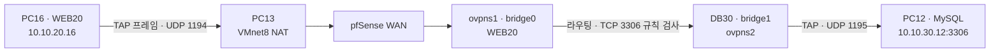

# BastionPay 개인 포트폴리오 · 심희현

- 팀 원본 [Elarin22/bastionpay](https://github.com/Elarin22/bastionpay)
- 개인 저장소 [Elarin22/bastionpay_](https://github.com/Elarin22/bastionpay_)
- 본인 역할 C · 팀장. Filebeat·Graylog와 Wazuh Agent의 로그 수집, 이벤트·상관 룰 설정, L2·S3 시연, 관제 서버 이전 및 수집 장애 분석을 담당했다. n8n 티켓 연동은 D와 함께 결과를 대조했다.

| 팀원 | 역할 | 팀 자료 출처 |
|---|---|---|
| 이학산 | A · 웹·DB | Spring Boot 앱, MySQL, 모의 은행과 API 시험 |
| 서효상 | B · pfSense | VMware, VLAN, TAP, 접근 정책과 차단·허용·원복 캡처 |
| 심희현 | C · SIEM | Graylog·Wazuh 설정과 수집, L2·S3 시연 |
| 최재영 | D · SOAR | n8n 워크플로, 티켓·알림·자동 조치 분기 |

팀 프로젝트는 모의 금융 웹 요청을 JSONL로 남기고, Graylog와 Wazuh가 각각 분석한 경보를 n8n으로 전달한다. n8n은 이벤트의 출발지 IP와 유형을 정규화하고 BastionPay의 인시던트 API를 호출한다. 열린 티켓이 있으면 갱신될 수 있다.

1. [새 PC에서 설치·실행](docs/INSTALL.md)
2. [VLAN 전체 설정과 재현](#vlan-전체-설정과-재현)
3. [시나리오 재현과 관찰 결과](docs/SCENARIOS.md)
4. [개인 작업 기록과 개선점](docs/CONTRIBUTIONS.md)

기준 소스는 개인 저장소 `e9e91478a1201344f5d267eb9248ca4390f41a5a`와 2026년 11월 팀 최종 발표자료다. 실습용 구성에서는 Graylog 예약 실행, n8n 외부 채널과 자동 차단·권한 조치를 초기 비활성 상태로 두었다. 새 PC에서 전체 실행 결과는 시나리오 문서에 직접 기록한다.

## VLAN 전체 설정과 재현

서효상이 VMware·pfSense·VLAN·OpenVPN TAP을 구성했다. 심희현은 팀 발표 피드백을 반영해 패킷 흐름과 차단·허용·원복 증거를 정리했다. 주소와 규칙은 팀 pfSense 백업 XML, 최종 발표자료 5번과 20~26번, 이후 적용 화면에 근거한다. 공개용 재현 시 CA, 인증서, TLS 인증 키와 GUI 비밀번호는 실습 환경에서 새로 발급한다.

### 1. VMware 어댑터와 주소

팀 실습은 PC13의 VMware Workstation에서 pfSense CE 2.7.2 VM을 실행했다. `em0`은 VMnet8 NAT, `em1`은 관리망, `em2`는 격리된 `LAB-TRUNK`의 802.1Q 부모 인터페이스다. 새 VM에서 가상 NIC 이름이 다르면 이 역할을 기준으로 연결한다.

| 구간 | pfSense 인터페이스 | VLAN 태그 | 주소와 용도 |
|---|---|---:|---|
| WAN | `wan / em0` | — | VMware NAT `192.168.254.0/24`. VMware 호스트 가상 어댑터 `192.168.254.1`, pfSense DHCP 예약 `192.168.254.129` |
| 관리 LAN | `lan / em1` | — | `10.10.10.1/24`, 관리 PC `10.10.10.2/24`. GUI `https://10.10.10.1` |
| WEB20 | `opt1 / em2.20` | 20 | `10.10.20.1/24`, PC16 TAP `10.10.20.16` |
| DB30 | `opt2 / em2.30` | 30 | `10.10.30.1/24`, PC12 TAP `10.10.30.12`, VLAN 검증용 Ubuntu `10.10.30.50` |
| SOC40 | `opt3 / em2.40` | 40 | `10.10.40.1/24`, PC17 TAP `10.10.40.17`. 관제 서버의 초기 배치 |
| SOAR50 | `opt4 / em2.50` | 50 | `10.10.50.1/24`. 구간은 정의했고, 시연 당시 n8n은 PC12에 배치 |
| TEST60 | `opt5 / em2.60` | 60 | `10.10.60.1/24`, Kali `10.10.60.10` |
| 예비 MGMT10 | `opt6 / em2.10` | 10 | 태그 정의와 인터페이스 배정. IP 미할당 |
| TAPWEB20 | `opt7 / ovpns1` | — | 별도 IP 없이 WEB20에 브리지 |
| TAPDB30 | `opt8 / ovpns2` | — | 별도 IP 없이 DB30에 브리지 |
| TAPSOC40 | `opt9 / ovpns3` | — | 별도 IP 없이 SOC40에 브리지 |

- WAN의 **Block private networks**는 해제했고 **Block bogon networks**는 유지했다. WAN이 VMnet8의 사설 IPv4 주소를 받는 구성이다.
- 관리 LAN은 고정 주소를 사용했다. 백업의 LAN DHCP 범위는 `10.10.10.10–10.10.10.245`로 저장돼 있으나 DHCP 서버는 비활성이다. TAP 주소는 아래 OpenVPN 설정으로 배정한다.
- 관리 GUI는 HTTPS로 사용한다. `ADMIN_HOSTS` 별칭은 `10.10.10.2`다. 백업 XML에는 LAN 자동 잠금 방지 규칙 해제 설정이 있으므로 새 VM에서 이 설정을 바꾸기 전 관리 PC의 허용 규칙을 적용하고 콘솔 복구 경로를 확보한다. DNS Resolver는 Unbound와 DNSSEC를 사용했다.
- 외부 학원망 주소는 PC13 `192.168.3.13`, PC16 `192.168.3.16`, PC12 `192.168.3.12`, PC17 `192.168.3.17`이었다. 각 PC의 TAP 주소와 동시에 존재할 수 있다.

### 2. OpenVPN TAP, 주소 풀과 브리지

VPN → OpenVPN → Servers에서 `Remote Access (SSL/TLS)`, `UDP IPv4`, 인터페이스 `WAN`, 장치 모드 `tap`으로 서버 3개를 만든다. IPv4·IPv6 Tunnel Network는 빈 값으로 둔다. Bridge DHCP를 켜고 서버마다 대응 VLAN과 풀을 지정한다. 이 설정 뒤 Interfaces → Assignments에서 `ovpns1~3`을 배정하고 Bridges 탭에서 VLAN과 TAP을 실제로 연결한다. [Netgate TAP 브리지 설정](https://docs.netgate.com/pfsense/en/latest/recipes/openvpn-bridged.html)

| 서버 | WAN UDP | Bridge DHCP 풀 | 클라이언트 CN과 고정 주소 | 서버의 IPv4 Local Network | RSTP 브리지 |
|---|---:|---|---|---|---|
| `TAP_WEB20_PC16` | 1194 | `10.10.20.16–10.10.20.17` | `PC16-WEB20` · `10.10.20.16/24` | `10.10.30.12/32` | `bridge0` · WEB20 + TAPWEB20 |
| `TAP_DB30_PC12` | 1195 | `10.10.30.12–10.10.30.13` | `PC12-DB30` · `10.10.30.12/24` | `10.10.20.16/32` | `bridge1` · DB30 + TAPDB30 |
| `TAP_SOC40_PC17` | 1196 | `10.10.40.17–10.10.40.18` | `PC17-SOC40` · `10.10.40.17/24` | `10.10.10.2/32`, `10.10.20.16/32`, `10.10.30.12/32` | `bridge2` · SOC40 + TAPSOC40 |

- 각 서버는 동시 클라이언트 1대, 자체 CA와 서버·클라이언트 인증서, TLS Authentication, 인증서 CN 일치 확인을 사용했다. 서버의 Custom options는 `verify-x509-name <해당 클라이언트 CN> name`이고, Client Specific Overrides에서 같은 CN과 서버를 선택해 표의 고정 주소를 넣는다.
- 데이터 채널 암호 협상 목록은 `AES-256-GCM`, `AES-128-GCM`, `CHACHA20-POLY1305`다. 폴백은 `AES-256-GCM`, 다이제스트는 `SHA256`, 압축은 비허용, 기본 게이트웨이 리디렉션은 미설정이었다.
- 클라이언트는 TAP을 지원하는 OpenVPN 클라이언트를 사용한다. 프로파일의 원격 주소는 PC13 `192.168.3.13`과 각 UDP 포트다. VPN 연결 후 Status → OpenVPN의 접속 CN과 TAP 주소, 클라이언트 라우팅을 확인한다. SOC40 방향도 실습하려면 발신 PC에서 `10.10.40.17`이 해당 TAP 경로로 해석되는지 확인한다. 위 표의 XML 설정에 WEB20·DB30 클라이언트용 SOC40 경로가 포함된 것으로 간주하지 않는다.
- System → Advanced → System Tunables에서 브리지 필터 적용 지점을 확인한다. 백업에는 `net.link.bridge.pfil_member`나 `net.link.bridge.pfil_bridge`의 별도 설정이 없었다. pfSense 기본값은 멤버 ingress 필터 `1`, 브리지 필터 `0`이다. 팀은 VLAN 인터페이스와 TAP 인터페이스 양쪽의 유입 규칙을 기록했다. [Netgate 브리지 방화벽 동작](https://docs.netgate.com/pfsense/en/latest/bridges/firewall.html)

### 3. VMware NAT 전달과 Windows 방화벽

VMware Virtual Network Editor → VMnet8 → NAT Settings → Port Forwarding에서 아래 매핑을 구성한다. 출발지 제한은 PC13 Windows 인바운드 방화벽과 pfSense WAN 규칙에 적용한다.

| PC13 수신 | pfSense WAN 전달 대상 | 허용 학원망 출발지 |
|---|---|---|
| UDP 1194 | `192.168.254.129:1194` | PC16 `192.168.3.16` |
| UDP 1195 | `192.168.254.129:1195` | PC12 `192.168.3.12` |
| UDP 1196 | `192.168.254.129:1196` | PC17 `192.168.3.17` |

VMnet8 DHCP 예약과 NAT·DHCP 서비스 실행을 확인한다. 팀의 PC13 학원망 HTTPS 443 규칙은 비활성 상태였다. 별도의 PC16 Windows 웹 방화벽에서 TCP 443 허용 IPv4 원격 주소는 `192.168.3.0/24`, `10.10.20.1`, `10.10.10.2`, `10.10.20.16`, `127.0.0.0/8`이었다. 나머지 IPv4와 `::1`을 제외한 원격 IPv6는 차단하도록 구성했다. 새 PC에 옮길 때는 팀 주소를 새 환경에 맞춰 지정한다.

### 4. pfSense 방화벽 규칙 전체

아래는 백업 XML의 **22개 규칙 중 활성 19개, 비활성 3개**다. 표 순서는 백업 순서다. IPv4는 표에 별도 표기가 없는 규칙의 주소 체계다. 로그 열은 규칙별 로그 기록 설정을 나타낸다. `WAN address`, `LAN address`, `SOC40 address`는 pfSense의 해당 인터페이스 주소다.

| # | 유입 탭 | 동작·상태 | 출발지 | 목적지·프로토콜 | 로그 |
|---:|---|---|---|---|---|
| 1 | WAN | Pass | `192.168.3.17` | WAN address · UDP 1196 | 켬 |
| 2 | WAN | Pass | `192.168.3.16` | WAN address · UDP 1194 | 켬 |
| 3 | WAN | Pass | `192.168.3.12` | WAN address · UDP 1195 | 켬 |
| 4 | WAN | Pass · 비활성 | `192.168.3.0/24` | `10.10.20.16` · TCP 443, NAT 연동 | 켬 |
| 5 | LAN | Block · IPv6 | Any | LAN address · TCP 443 | 켬 |
| 6 | LAN | Block | `!ADMIN_HOSTS` | LAN address · TCP 443 | 켬 |
| 7 | LAN | Pass | `ADMIN_HOSTS` | LAN address · TCP 443 | 켬 |
| 8 | LAN | Pass · 기본 | LAN net | Any · Any | 끔 |
| 9 | LAN | Pass · 기본 IPv6 | LAN net | Any · Any | 끔 |
| 10 | LAN | Pass | `192.168.3.0/24` | `10.10.20.16` · TCP 443 | 켬 |
| 11 | WEB20 | Pass · 기존 시험 | `10.10.20.0/24` | `10.10.30.10` · TCP 3306 | 켬 |
| 12 | WEB20 | Pass | `10.10.20.16` | `10.10.30.12` · TCP 3306 | 켬 |
| 13 | WEB20 | Pass | `10.10.20.16` | `10.10.30.12` · TCP 3307 | 켬 |
| 14 | WEB20 | Pass | `10.10.20.16` | `10.10.30.12` · TCP 8090 | 켬 |
| 15 | DB30 | Pass · 비활성 | `10.10.30.10` | Any · TCP 80, 임시 HTTP 시험 | 끔 |
| 16 | DB30 | Pass | `10.10.30.10` | `10.10.30.1` · TCP/UDP 53 | 끔 |
| 17 | SOC40 | Pass | `10.10.40.17` | SOC40 address · ICMP | 켬 |
| 18 | TEST60 | Pass · 비활성 | `10.10.60.10` | `192.168.3.16` · TCP 8080, 임시 앱 접근 시험 | 켬 |
| 19 | TAPWEB20 | Pass | `10.10.20.16` | `10.10.30.12` · TCP 3306 | 켬 |
| 20 | TAPWEB20 | Pass | `10.10.20.16` | `10.10.30.12` · TCP 3307 | 켬 |
| 21 | TAPWEB20 | Pass | `10.10.20.16` | `10.10.30.12` · TCP 8090 | 켬 |
| 22 | TAPSOC40 | Pass | `10.10.40.17` | SOC40 address · ICMP | 켬 |

백업의 SOAR50·MGMT10·TAPDB30에는 사용자 정의 규칙이 없었다. 아래 후속 작업에서 TAPDB30을 포함한 네 탭에 SOC40 수집 규칙을 추가했다. 신규 VLAN 간 연결은 명시적으로 허용한 경우 통과하고, 허용 규칙에 일치하지 않은 유입은 기본 차단된다. LAN에는 위 표의 기본 Any 허용 규칙이 남아 있었다. TEST60에서 `10.10.30.50:8080`으로 보낸 재현 시험과 #18의 학원망 웹 접근 시험은 목적지가 다르다.

#### 11월 4일 SOC40 수집 허용 추가 8개

Firewall → Aliases → Ports에서 `SOC40_INGEST_TCP`는 `1514:1515`, `5044`, `12201`, `SOC40_INGEST_UDP`는 `1514`, `12201`로 구성했다. 아래 규칙은 모두 IPv4 Pass, 목적지 `10.10.40.17/32`, 로그 기록을 사용했다. 팀의 후속 적용 기록으로 확인한 정책이며, 백업의 기본 규칙 수와 합쳐 현재 활성 개수로 계산하지 않는다.

| 유입 탭 | 출발지 | TCP 규칙 목적지 포트 | UDP 규칙 목적지 포트 |
|---|---|---|---|
| WEB20 | `10.10.20.16/32` | `SOC40_INGEST_TCP` | `SOC40_INGEST_UDP` |
| TAPWEB20 | `10.10.20.16/32` | `SOC40_INGEST_TCP` | `SOC40_INGEST_UDP` |
| DB30 | `10.10.30.12/32` | `SOC40_INGEST_TCP` | `SOC40_INGEST_UDP` |
| TAPDB30 | `10.10.30.12/32` | `SOC40_INGEST_TCP` | `SOC40_INGEST_UDP` |

팀 기록에 따르면 필터 재적용이 완료됐고 규칙 일치 로그 2건이 남았다. Graylog·Wazuh는 이후 PC17에서 PC16으로 이전했다. 위 규칙의 목적지는 이전 배치 주소이며, 규칙 일치와 관제 서비스의 최종 수신 여부는 각각 확인해야 한다. [서효상 · SOC40 규칙 적용 화면](docs/evidence/12_pfsense_soc40_rules_after.jpeg)

### 5. 정적 경로와 HTTPS NAT

| 설정 위치 | 구성값 |
|---|---|
| PC13 Windows 정적 경로 | `10.10.20.16/32`를 관리 LAN 게이트웨이 `10.10.10.1`로 전달 |
| pfSense System → Routing → Gateways | `LAN_PC13_DIRECTWEB`, LAN 인터페이스, IPv4 next hop `10.10.10.2` |
| pfSense System → Routing → Static Routes | `192.168.3.0/24`의 next hop을 `LAN_PC13_DIRECTWEB`로 지정 |
| Firewall → NAT → Outbound | Hybrid, egress `WEB20`, IPv4 TCP, `192.168.3.0/24` → `10.10.20.16/32:443`의 소스를 WEB20 주소 `10.10.20.1`로 변환 |
| Firewall → NAT → Outbound | 같은 조건으로 `10.10.10.2/32` → `10.10.20.16/32:443`의 소스를 `10.10.20.1`로 변환 |
| Firewall → NAT → Port Forward | `192.168.3.0/24` → WAN address TCP 443 → `10.10.20.16:443` 규칙과 WAN 연동 Pass 규칙은 비활성 |

PC13에서 원래 실습 주소를 재현하는 경우 관리자 PowerShell로 `route.exe -p add 10.10.20.16 mask 255.255.255.255 10.10.10.1`을 적용한 뒤 `route.exe print 10.10.20.16`으로 확인한다. 학원망의 다른 PC도 PC13을 경유시키는 재현이라면 해당 PC의 목적지 라우팅과 PC13의 전달 설정을 별도로 확인한다.

WEB20 쪽 SNAT는 웹 응답을 pfSense 방화벽 상태로 되돌려 비대칭 경로를 줄인다. 이 경로에서는 웹 서버가 원래 학원망 출발지 대신 `10.10.20.1`을 볼 수 있으므로, 웹 앱 `source_ip`와 pfSense 로그를 대조할 때 NAT 구간을 고려한다. 같은 학원망에서 PC16의 물리 주소로 직접 접근하는 흐름도 있었으므로 도달성만으로 VLAN을 경유했다고 판정할 수 없다.

### 6. 패킷이 통과하는 순서



1. PC16은 다른 서브넷인 DB30의 MySQL로 TCP SYN을 보낸다. PC16의 라우팅과 ARP가 WEB20 게이트웨이를 다음 홉으로 선택한다.
2. TAP이 이더넷 프레임을 캡슐화해 UDP 1194로 운반한다. VMware NAT 전달을 거쳐 pfSense에서 캡슐을 풀고 `ovpns1`과 WEB20 브리지에서 처리한다. `em2` trunk로 나가는 프레임은 해당 VLAN 인터페이스의 태그를 사용한다.
3. pfSense가 DB30으로 라우팅하며 유입 인터페이스의 출발지·목적지·포트 규칙을 검사한다. 허용된 연결의 응답은 생성된 방화벽 상태에 일치한다. DB30의 TAP 브리지가 프레임을 PC12에 전달한다.
4. 팀 시험에서 MySQL 3306은 연결됐고, 은행 API 8090은 HTTP 404 응답으로 프로세스까지 도달했다. 3307은 당시 MockBank DB가 루프백에 바인딩돼 VPN에서 접근할 수 없었다.

### 7. 새 PC 또는 VM에서 구성하고 시험

1. VMware에서 pfSense에 WAN NAT, 관리 Host-only, 격리 `LAB-TRUNK` NIC를 연결한다. 관리 PC에서 GUI에 접속한 뒤 Interfaces → Assignments → VLANs에서 부모 인터페이스에 태그 `10·20·30·40·50·60`을 만든다. Assignments에서 VLAN을 배정하고 1번 표의 IPv4 주소를 지정한다. 예비 MGMT10과 관리 LAN의 대역을 중복 할당하지 않는다.
2. 팀 PC 연결까지 재현할 때는 2번 표대로 인증서·TAP 서버·브리지·Client Specific Overrides를 구성하고 3번의 NAT 전달과 출발지 제한을 적용한다. 4번의 관리·서비스 규칙과 5번의 필요한 경로를 적용한다. 외부 Windows PC 없이 VLAN 차단 시험만 할 때는 아래의 격리 trunk에 Kali와 Ubuntu를 연결하고 VLAN 인터페이스만 만든다.
3. `ip -br link`로 VM의 NIC 이름을 확인한다. 아래 `eth0`을 각 VM의 실제 NIC 이름으로 바꿔 실행한다.

```bash
# Kali VM
sudo ip link add link eth0 name eth0.60 type vlan id 60
sudo ip addr add 10.10.60.10/24 dev eth0.60
sudo ip link set eth0.60 up
sudo ip route replace 10.10.30.0/24 via 10.10.60.1 dev eth0.60
ip route get 10.10.30.50

# Ubuntu VM
sudo ip link add link eth0 name eth0.30 type vlan id 30
sudo ip addr add 10.10.30.50/24 dev eth0.30
sudo ip link set eth0.30 up
sudo ip route replace 10.10.60.0/24 via 10.10.30.1 dev eth0.30
mkdir -p /tmp/bastionpay-vlan-test
printf 'VLAN30 lab test\n' > /tmp/bastionpay-vlan-test/index.html
python3 -m http.server 8080 --bind 10.10.30.50 --directory /tmp/bastionpay-vlan-test
```

4. Kali의 `ip route get`에서 다음 홉 `10.10.60.1`을 확인한다. TEST60에 임시 허용을 넣기 전 다음 요청을 보내고 Status → System Logs → Firewall에서 `TEST60`, 출발지 `10.10.60.10`, 목적지 `10.10.30.50`, TCP 8080으로 조회한다.

```bash
curl --connect-timeout 3 --max-time 5 -i http://10.10.30.50:8080/
```

5. Firewall → Rules → TEST60에 `IPv4 TCP`, 출발지 `10.10.60.10/32`, 목적지 `10.10.30.50/32`, 목적지 포트 `8080`, `Pass`, `Log`를 추가하고 Apply 한다. 같은 요청에서 HTTP 200과 Pass 로그를 확인한다.
6. 임시 규칙을 제거하고 Apply 한다. Diagnostics → States에서 이 시험 연결에 해당하는 상태만 종료한 뒤 새 연결의 timeout과 Default deny를 확인한다. Ubuntu의 임시 서버를 중지한다. 로그 건수에는 SYN 재전송이 포함될 수 있으므로 요청 횟수와 구분한다.
7. WEB20·DB30의 TAP까지 재현했다면 PC16 PowerShell에서 `Test-NetConnection 10.10.30.12 -Port 3306`을 실행한다. pfSense 캡처에서 WEB20/TAPWEB20 유입과 DB30/TAPDB30 송신을 대조한다. 서비스 응답, 방화벽 로그, 출발지 주소를 기록한다.

### 8. 팀 검증 결과와 발표 보완

| 시험 | 기존 관찰 | 근거 |
|---|---|---|
| 2026-10-27 TEST60 → DB30 TCP 8080 기본 차단 | Default deny 3건, 화면 시각 `13:24:54–56` | [서효상 · 차단](docs/evidence/13_kali_test_1_default_deny.png) |
| 같은 경로 임시 허용 | `HTTP/1.0 200 OK`, 본문 `VLAN30 lab test`. 팀 발표의 Pass 로그 3건 | [서효상 · 응답](docs/evidence/14_kali_test_2_temp_allow.png) |
| 같은 경로 임시 규칙 원복 | Default deny 추가 3건, 화면 시각 `16:28:32–34`. 필터 누적 6건 | [서효상 · 원복](docs/evidence/15_kali_test_3_revert.png) |
| WEB20 → DB30 | TCP 3306 연결과 API 8090 HTTP 404를 확인. 3307은 로컬 바인딩 제약 | 팀 발표자료 22번 및 기존 작업 기록 |
| TEST60 → PC16 물리 IP TCP 8080 | 기본 차단 후 임시 허용에서 TLS 필요 HTTP 400 응답. 시험 규칙 비활성화 | 팀 기존 작업 기록 |
| PC13에서 웹 접근 | 학원망에서 `https://192.168.3.16/`, 관리망에서 `https://10.10.20.16/` HTTP 200 | 팀 기존 작업 기록 |
| SOC40 수집 | 후속 규칙 적용·일치 로그 2건. 서버 이전 후 기존 SOC40 목적지의 종단 수신 미확인 | 팀 발표자료 25번 및 적용 화면 |

발표에서는 구성도와 결과 화면 사이의 연결 설명이 빠졌다. 위 패킷 흐름과 시험 규칙을 함께 읽으면 요청이 어떤 인터페이스에 도착하고 어느 조건에서 통과하는지 설명할 수 있다. 표는 기존 팀 시험 결과다. 새 PC나 VM의 결과는 재현한 뒤 [시나리오 기록](docs/SCENARIOS.md)에 날짜와 증거를 추가한다.
