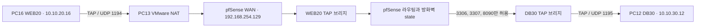

# BastionPay VLAN과 패킷 흐름

주소, OpenVPN 설정값, 방화벽 규칙 전체, NAT와 정적 경로는 [루트 README의 VLAN 전체 설정](../README.md#vlan-전체-설정과-재현)에서 확인한다.

발표 피드백에서는 망 구성도 외에 실제 VLAN 동작을 설명할 필요가 있다고 지적받았다. 팀에서 서효상이 VMware·pfSense·TAP을 구성했고, 이 문서는 심희현이 개인 포트폴리오에서 해당 경로를 설명할 수 있도록 팀 발표자료 5, 20~26번 슬라이드와 시험 캡처를 바탕으로 정리했다.

| 구간 | pfSense 인터페이스 / 주소 | 팀 실습의 역할 |
|---|---|---|
| 관리 LAN | `em1` · `10.10.10.1/24` | 관리 PC만 pfSense GUI 접근 |
| WEB20 | `em2.20` · `10.10.20.1/24` | PC16 웹, TAP `10.10.20.16` |
| DB30 | `em2.30` · `10.10.30.1/24` | PC12 DB·은행 API, TAP `10.10.30.12` |
| SOC40 | `em2.40` · `10.10.40.1/24` | PC17의 초기 관제 위치, TAP `10.10.40.17` |
| SOAR50 | `em2.50` · `10.10.50.1/24` | 정의된 구간. 당시 n8n은 PC12에 배치 |
| TEST60 | `em2.60` · `10.10.60.1/24` | Kali 시험 VM `10.10.60.10` |
| 예비 MGMT10 | `em2.10` | VLAN 정의. 활성 관리 경로는 `em1` |

## WEB20에서 DB30으로 가는 연결



1. PC16의 `10.10.20.16`에서 `10.10.30.12:3306`으로 TCP SYN을 보낸다. 목적지가 다른 서브넷이어서 WEB20 게이트웨이의 MAC 주소로 이더넷 프레임을 만든다.
2. OpenVPN TAP이 이 프레임을 UDP 1194 터널로 운반한다. PC13 VMware NAT는 외부 UDP를 pfSense WAN에 전달한다. pfSense는 VPN 캡슐을 해제하고 TAP과 WEB20을 잇는 브리지에서 프레임을 처리한다. `em2` trunk에 나가는 프레임에는 인터페이스에 해당하는 802.1Q VLAN 태그가 붙는다.
3. pfSense는 WEB20에서 DB30으로 L3 라우팅하고, 유입 인터페이스에 적용된 규칙에서 출발지·목적지·TCP 포트를 검사한다. 팀 설정은 WEB20과 TAPWEB20 양쪽에 동일한 제한 규칙을 두었다. 허용된 TCP 연결의 응답은 방화벽 상태에 일치해 돌아온다. DB30으로 나가는 프레임은 해당 TAP 브리지와 UDP 1195 터널을 통해 PC12에 전달된다.
4. 서비스 리스너와 호스트 방화벽도 최종 도달성을 좌우한다. 팀 기록에서 TCP 3306은 도달했고, 8090은 HTTP 404로 프로세스 응답까지 확인했다. MockBank DB의 3307은 당시 로컬 바인딩 때문에 VPN 접속이 제한됐다.

PC16·PC12·PC17의 학원망 IP는 그대로 존재한다. 같은 학원 서브넷에서 물리 IP로 직접 접근한 패킷은 pfSense를 우회할 수 있다. 팀은 Graylog·Wazuh를 PC17에서 PC16으로 옮겼다. 이전 SOC40 목적지에 남은 규칙의 일치 기록은 이전 뒤 수집 성공의 근거로 사용하지 않았다. VLAN 경유 여부는 목적지 IP, 클라이언트 라우팅, pfSense의 패킷 캡처와 규칙 로그를 함께 본다.

## 새 VM에서 차단·허용·원복 재현

1. VMware에 pfSense CE VM을 만들고 NIC 세 개를 연결한다. WAN은 NAT, 관리는 Host-only, trunk는 격리된 Custom VMnet 또는 LAN Segment를 사용한다. 관리 LAN을 `10.10.10.1/24`로 설정하고 관리 호스트 `10.10.10.2/24`로 접속한다. 기본 관리 비밀번호를 교체한다.
2. Interfaces → Assignments → VLANs에서 trunk parent에 20·30·40·50·60을 생성한다. Assignments에서 각각 활성화하고 위 표의 `/24` 게이트웨이를 준다. 팀의 예비 VLAN 10을 재현하는 경우 관리 LAN과 동일 대역을 중복 할당하지 않는다.
3. Kali·Ubuntu VM을 같은 격리 trunk 세그먼트에 놓는다. 실제 인터페이스 이름을 `ip -br link`로 확인한다. Kali에는 태그 60, Ubuntu에는 태그 30을 설정한다. 아래의 `eth0`은 각 VM의 인터페이스로 바꾼다. 인터넷용 NIC가 있다면 기본 경로 변경 대신 시험 상대 대역으로만 라우트를 둔다.

```bash
# Kali
sudo ip link add link eth0 name eth0.60 type vlan id 60
sudo ip addr add 10.10.60.10/24 dev eth0.60
sudo ip link set eth0.60 up
sudo ip route replace 10.10.30.0/24 via 10.10.60.1 dev eth0.60
# Ubuntu
sudo ip link add link eth0 name eth0.30 type vlan id 30
sudo ip addr add 10.10.30.50/24 dev eth0.30
sudo ip link set eth0.30 up
sudo ip route replace 10.10.60.0/24 via 10.10.30.1 dev eth0.30
mkdir -p /tmp/bastionpay-vlan-test
printf 'VLAN30 lab test\n' > /tmp/bastionpay-vlan-test/index.html
python3 -m http.server 8080 --bind 10.10.30.50 --directory /tmp/bastionpay-vlan-test
```

4. Kali에서 `ip route get 10.10.30.50`의 next hop이 `10.10.60.1`인지 확인한다. `curl --connect-timeout 3 --max-time 5 -i http://10.10.30.50:8080/`로 시험한다. TEST60 규칙에 허용이 없으면 timeout과 Default deny를 확인한다. 이어 TEST60 ingress에 `10.10.60.10/32`에서 `10.10.30.50/32` TCP 8080만 허용하고 로그를 켠다. Apply 후 같은 요청에서 HTTP 200 및 Pass 로그를 확인한다.
5. 임시 허용을 제거하고 Apply 한다. Diagnostics → States에서 시험 연결과 일치하는 상태만 종료한 뒤 새 연결로 timeout·Default deny를 확인한다. Ubuntu의 임시 서버를 중지한다. 로그 건수는 SYN 재전송을 포함할 수 있으므로 연결 횟수와 구분한다.

팀 PC 연결까지 재현한다면 자체 CA를 새로 생성하고 OpenVPN 서버를 TAP으로 구동한다. UDP 1194·1195·1196을 각각 WEB20·DB30·SOC40에 대응시킨다. Assignments로 TAP 인터페이스를 배정하고 Interfaces → Assignments → Bridges에서 대응 VLAN과 한 쌍으로 브리지한다. 클라이언트별 인증서와 고정 주소를 발급하고 각 유입 지점에 필요한 포트만 허용한다. VMware NAT 포트 전달의 출발지 제한은 호스트 방화벽과 함께 확인한다. 브리지 필터 적용 지점은 pfSense tunable 및 캡처로 확인한다.

## 팀 시험 기록 · 2026-10-27

| 단계 | 관찰 결과 | 캡처 출처 |
|---|---|---|
| 기본 차단 | TEST60 Default deny 3건. 화면 시각 13:24:54~56 | [서효상 · 차단](evidence/13_kali_test_1_default_deny.png) |
| 임시 허용 | `HTTP/1.0 200 OK` 및 본문 `VLAN30 lab test`. 팀 발표에는 Pass 로그 3건 기록 | [서효상 · 도달](evidence/14_kali_test_2_temp_allow.png) |
| 원복 | Default deny 추가 3건, 화면 시각 16:28:32~34. 필터 누적 6건 | [서효상 · 원복](evidence/15_kali_test_3_revert.png) |

공식 문서 [pfSense 브리지 방화벽](https://docs.netgate.com/pfsense/en/latest/bridges/firewall.html), [OpenVPN 인터페이스](https://docs.netgate.com/pfsense/en/latest/vpn/openvpn/assign.html).
